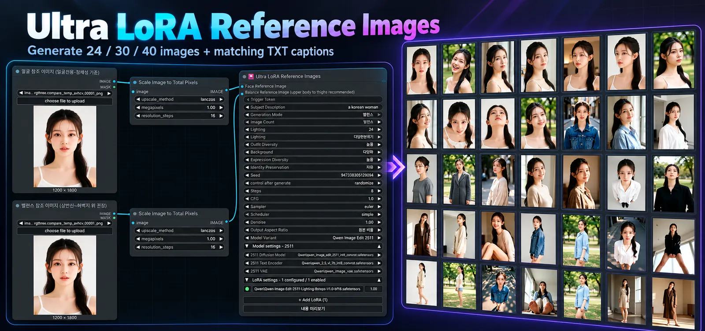

# 🎴 Ultra LoRA Reference Images

**인물 사진 한두 장만 넣으면, 같은 인물의 다양한 표정·얼굴 각도·구도·의상·배경을 담은 이미지 24 / 30 / 40장을 한 번에 만들어 주는 ComfyUI 노드입니다.**


> **English:** Generate 24, 30, or 40 consistent character reference images and matching TXT captions from one or two photos. **[Read the full English guide ↓](#english-guide)**

### 🖼️ 프로그램 화면 / Application preview



*Ultra LoRA Reference Images — 얼굴·밸런스 모드에서 24 / 30 / 40장의 인물 참조 이미지와 각 이미지에 대응하는 TXT 캡션을 생성합니다.*

이렇게 쓸 수 있습니다.
- **캐릭터 시트 / 표정 모음:** 한 인물의 여러 표정과 각도를 한자리에 모읍니다.
- **포즈·구도 레퍼런스:** 같은 인물의 얼굴 클로즈업부터 상반신, 허벅지 위, 전신까지 고루 만듭니다.
- **인물 LoRA 학습용 데이터셋:** 이미지마다 같은 이름의 TXT 캡션이 자동으로 저장되어, 그대로 학습에 쓸 수 있습니다.

정한 장수만큼 이미지마다 **표정, 얼굴 각도, 시선, 조명, 배경**이 자동으로 바뀝니다. 밸런스 모드에서는 몸이 나오는 컷마다 **의상도 자동으로 바뀝니다.** 이 과정에서 얼굴은 같은 인물로 유지됩니다.

- ✅ **추가 pip 설치 없음**
- ✅ **로더 연결 불필요:** 모델, 텍스트 인코더, VAE, LoRA를 노드 안에서 고릅니다.
- ✅ **한국어 / 영어 UI 자동 전환**
- ✅ **예제 워크플로우와 상세 메뉴얼 포함**

---

## 📦 설치

**ComfyUI Manager (권장)**
Custom Nodes Manager에서 **`Ultra LoRA Reference Images`** 를 검색해 설치합니다.

**수동 설치**
```bash
cd ComfyUI/custom_nodes
git clone https://github.com/Yamoon-jjang/comfyui-Ultra-LoRA-Reference-Images
```
설치 후 ComfyUI를 재시작하세요.

**필요한 모델:** Qwen Image Edit 2511 또는 Qwen Image 2.1 (Diffusion Model / Text Encoder / VAE)

---

## 🚀 빠른 시작

1. `예제/Ultra-LoRA-Reference-Images.json` 워크플로우를 불러옵니다.
2. 얼굴 참조 이미지를 넣습니다. 밸런스 모드라면 같은 인물의 두 번째 이미지도 넣습니다.
3. `모델 계열`(2511 또는 2.1)을 고르고, `모델 설정`을 펼쳐 내 모델 파일을 선택합니다.
4. 생성 모드와 장수(24 / 30 / 40)를 고른 뒤 실행합니다.

결과는 `ComfyUI/output/lora_dataset/<실행 폴더>/`에 **PNG + 같은 이름의 TXT 캡션**으로 저장됩니다.

---

## 🎭 두 가지 생성 모드

### 얼굴전용: 참조 이미지 1장
얼굴 중심 컷만 만듭니다. 이미지마다 **표정, 얼굴 각도, 시선, 조명, 배경**이 바뀝니다. 표정 모음이나 얼굴 LoRA에 적합합니다. 의상은 바꾸지 않습니다.

### 밸런스: 참조 이미지 2장 (같은 인물)
얼굴, 상반신, 허벅지 위, 전신 컷을 섞어 만듭니다. 몸이 나오는 컷마다 **의상과 포즈가 바뀝니다.**

| 장수 | 얼굴 | 상반신 | 허벅지 위 | 전신 |
|---|---|---|---|---|
| 24장 | 9 | 7 | 5 | 3 |
| 30장 | 11 | 9 | 6 | 4 |
| 40장 | 14 | 12 | 8 | 6 |

> 💡 두 번째 이미지는 상반신 사진이 가장 좋습니다. 없으면 같은 인물의 얼굴 사진 2장을 넣어도 정상적으로 동작합니다.

---

## 🎛️ 변화 정도 조절

| 옵션 | 선택지 | 하는 일 |
|---|---|---|
| **표정 변화** | 낮음 / 보통 / 높음 | 웃음, 슬픔, 놀람, 화남 등 표정 후보의 폭 |
| **의상 다양성** | 낮음(4종) / 보통(8종) / 높음(12종) | 밸런스 모드 몸 컷에 쓰는 의상 후보 수 |
| **배경 옵션** | 단순 / 실내실외혼합 / 다양화 | 스튜디오, 실내, 창가, 거리, 공원, 카페 등 배경 범위 |
| **조명 옵션** | 사용안함 / 안정적분산 / 다양한분산 | 자연광, 창가광, 스튜디오, 측광 등 조명 변화 |
| **정체성 보존** | 강함 / 균형 / 자유 | 원본 얼굴을 얼마나 엄격하게 유지할지 |
| **출력 비율** | 원본 비율 / 자동 구도별 비율 | 구도에 맞춰 화면 비율 조정 |

트리거 토큰과 피사체 설명(예: `a korean woman`)을 넣으면 캡션에도 반영됩니다.

---

## ⚙️ 편의 기능

- **노드 안에서 모델 선택:** 바깥에 Loader 노드를 연결할 필요가 없습니다.
- **모델 계열별 LoRA 목록:** LoRA를 추가, 삭제, 순서 이동, ON/OFF, 강도 조절할 수 있습니다. 2511용과 2.1용 목록은 서로 섞이지 않습니다.
- **마지막 설정 자동 기억:** 2511과 2.1 각각의 모델과 LoRA 설정을 따로 기억해서, 계열을 바꾸면 그 계열에서 쓰던 설정이 그대로 돌아옵니다.
- **실행 전 생성 계획 미리보기:** 어떤 컷이 몇 장 만들어질지 먼저 확인할 수 있습니다.
- **모델별 최적 내부 처리:** 2511은 CFGNorm과 멀티 레퍼런스 latent, 2.1은 전용 캐시와 인코더를 노드가 알아서 적용합니다.

---

## ✅ 학습에 쓰기 전에

자동 생성 결과는 한 번 훑어보시길 권장합니다. 얼굴이 같은 인물로 유지됐는지, 손이나 몸이 깨진 컷은 없는지 확인하세요. 문제 있는 PNG/TXT 쌍은 빼거나 캡션을 고치면 됩니다.

자세한 설명은 [`Ultra_LoRA_Reference_Images_메뉴얼.txt`](Ultra_LoRA_Reference_Images_메뉴얼.txt)를 참고하세요.

---

## 📄 라이선스

**GNU GPL v3.0** (`LICENSE`) · Copyright (C) 2026 Yamoon-jjang

---

## 🇺🇸 English Guide

### Overview

**Ultra LoRA Reference Images** is a ComfyUI custom node for turning **one or two reference photos of the same person** into a structured collection of **24 / 30 / 40 reference images**, each saved as a **PNG with a matching TXT caption**.

The node plans variations in **facial expression, head angle, gaze, lighting, and background** while aiming to preserve the subject's identity. In **Balance mode**, it also covers different framings, body poses, and outfits. The generated pairs can be used for:

- **Character reference sheets:** multiple views and expressions of a consistent character.
- **Portrait and pose references:** face close-ups, upper-body, thigh-up, and full-body compositions.
- **Person LoRA training datasets:** organized PNG/TXT pairs that you can review and use in a training workflow.

**Key conveniences:** Korean/English interface localization, an included example ComfyUI workflow, model selection and LoRA management inside the node, per-model-family settings memory, and **no additional pip packages required by this custom node**.

> **Supported model families:** **Qwen Image Edit 2511** and **Qwen Image 2.1**. You must have the corresponding diffusion model, text encoder, and VAE files available in ComfyUI; the models are **not included** in this repository.

### Installation

**Option A — ComfyUI Manager (recommended):** Open Custom Nodes Manager, search for **Ultra LoRA Reference Images**, install it, and restart ComfyUI.

**Option B — Manual Git installation:**

```bash
cd ComfyUI/custom_nodes
git clone https://github.com/Yamoon-jjang/comfyui-Ultra-LoRA-Reference-Images
```

Restart ComfyUI after installation. For a packaged download, see the [latest GitHub Release](https://github.com/Yamoon-jjang/comfyui-Ultra-LoRA-Reference-Images/releases/latest). If installing from a ZIP, ensure `__init__.py`, `reference_images.py`, `web`, `locales`, and `예제` are directly inside the installed custom-node folder, **not inside an extra nested folder**.

### Quick Start

1. Load the included example workflow: **[`예제/Ultra-LoRA-Reference-Images.json`](예제/Ultra-LoRA-Reference-Images.json)**.
2. Connect a clear **face reference image**. To use **Balance mode**, also connect a **second image of the same person** (an upper-body reference is recommended).
3. Select the **Model Family**: **Qwen Image Edit 2511** or **Qwen Image 2.1**.
4. Expand **Model Settings** and choose the installed **Diffusion Model, Text Encoder, and VAE** files for that family. The filenames saved in the example workflow may not match yours.
5. Choose **Face** or **Balance**, the image count (**24 / 30 / 40**), and the desired variation options. Optionally enable compatible LoRAs in the node's LoRA section.
6. Queue the workflow in ComfyUI and review the generated images and caption files.

**Saved output location:**

```text
ComfyUI/output/lora_dataset/<run-folder>/
    <image-name>.png
    <image-name>.txt
```

Every generated image has a **TXT caption with the same base filename**. The optional **Trigger Token** and **Subject Description** (for example, `a korean woman`) are incorporated into the generated captions.

### Generation Modes

**Face mode — 1 reference image**

- Creates face-centered compositions with varied expressions, head angles, gaze, lighting, and backgrounds.
- Suitable for portrait expression sheets and face-focused LoRA datasets.
- Does **not** intentionally diversify outfits; changing clothing is not the purpose of this mode.

**Balance mode — 2 references of the same person**

- Combines **face close-ups, upper-body, thigh-up, and full-body** images.
- Uses the face reference for identity and a second reference to help establish body proportions and framing.
- Varies **outfits and poses on body-focused images**. Face close-ups do not receive the same outfit-changing instructions.
- The second reference is ideally an upper-body image. Two face photos of the same person can also be used, but body-proportion and framing guidance may be weaker.
- **Do not use photos of two different people** as the two inputs; their identity and appearance cues may conflict.

**Balance mode shot distribution:**

| Total images | Face | Upper body | Thigh-up | Full body |
|---:|---:|---:|---:|---:|
| 24 | 9 | 7 | 5 | 3 |
| 30 | 11 | 9 | 6 | 4 |
| 40 | 14 | 12 | 8 | 6 |

### Variation Controls

| Setting | Available choices | What it changes |
|---|---|---|
| **Expression Diversity** | Low / Medium / High | Range of planned expressions, such as smiling, surprise, sadness, and anger |
| **Outfit Diversity** | Low (4) / Medium (8) / High (12) | Size of the outfit candidate pool for body-focused images in Balance mode |
| **Background** | Simple / Mixed indoor-outdoor / Diverse | Range of locations such as studio, window light, street, park, and café |
| **Lighting** | Off / Stable variation / Diverse variation | How widely lighting conditions vary across images |
| **Identity Preservation** | Strong / Balanced / Free | How strongly prompts emphasize preserving the reference identity |
| **Output Aspect Ratio** | Original ratio / Automatic by composition | Whether image proportions follow the input or the planned framing |

**Suggested starting point:** Face mode, **24 images**, medium expression diversity, simple backgrounds, stable lighting variation, and balanced identity preservation. In Balance mode, **medium outfit diversity** offers a practical starting point.

### Model and LoRA Management

- **No separate model-loader wiring:** select the diffusion model, text encoder, and VAE from the node itself.
- **Two supported model paths:** the node uses the appropriate internal processing for **Qwen Image Edit 2511** or **Qwen Image 2.1**, rather than treating them as interchangeable model files.
- **Built-in LoRA list:** add or remove LoRAs, enable/disable entries, change strengths, and reorder the application sequence.
- **Separate saved settings per model family:** the selected model files and LoRA configuration for 2511 and 2.1 are remembered independently in the same browser profile.
- **Persistence:** model-related selections are saved as you change them using the browser's local storage; workflow files also store their settings. Clearing browser site storage may reset the remembered selections.
- **Sampling parameters:** Seed, Steps, CFG, Sampler, Scheduler, and Denoise are general generation settings; switching model families does not automatically change them.

> Use **LoRA files compatible with the selected model family**. A LoRA intended for 2511 is not automatically compatible with Qwen Image 2.1.

### Reviewing a Dataset Before Training

The node **generates reference images and captions**; it does not train a LoRA by itself. Before adding the results to a training dataset, inspect them for:

- Consistent facial identity and hairstyle across views.
- Distorted hands, arms, legs, anatomy, or cropping.
- Unexpected clothing repetition in Balance mode.
- Mismatches between the image content and its TXT caption.

Remove unsuitable **PNG/TXT pairs**, or revise individual captions where necessary. Reference-guided generation aims for consistency but does **not guarantee** perfect identity or anatomy in every output.

### Troubleshooting

**Node appears missing or with a red outline:** Restart ComfyUI, avoid duplicate installations under different folder names, and check that the correct model files are selected under **Model Settings**.

**Balance mode does not run:** Verify that the second **Balance Reference Image** input is connected. Both references should show the same person.

**Clothing seems unchanged:** Outfit variation primarily affects **body-focused outputs in Balance mode**, not Face mode. Try medium or high outfit diversity.

**Settings seem to reset after switching models:** 2511 and 2.1 keep separate model/LoRA selections. Browser local-storage cleanup can also clear the remembered values.

**Unexpected output or poor identity consistency:** Check the input image quality, matching identity across references, model compatibility, and the generated plan. Inspect results before using them in training.

### Documentation, Downloads, and License

- **[Latest Release / Download ZIP](https://github.com/Yamoon-jjang/comfyui-Ultra-LoRA-Reference-Images/releases/latest)**
- **[Example ComfyUI workflow](예제/Ultra-LoRA-Reference-Images.json)**
- **[Detailed Korean user manual](Ultra_LoRA_Reference_Images_메뉴얼.txt)**
- **[Report an issue](https://github.com/Yamoon-jjang/comfyui-Ultra-LoRA-Reference-Images/issues)**

**License:** GNU GPL v3.0 — see [LICENSE](LICENSE). Copyright (C) 2026 Yamoon-jjang.
